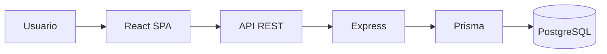

# Actividad 1 — Arquitectura web moderna

JustiTurno organiza la solicitud y atención de citas de una Casa de Justicia. Ciudadanos solicitan y consultan citas; funcionarios gestionan su agenda; administradores configuran servicios, requisitos, horarios y usuarios.

El frontend React/Vite es una SPA con rutas protegidas por rol. La API Express responde JSON, valida con Zod y usa Prisma para PostgreSQL. React consume servicios HTTP separados con cookies de sesión httpOnly.

Decisiones: SPA para navegación ágil; API REST para separar interfaz y reglas; PostgreSQL para relaciones entre usuarios, servicios y citas; Prisma para migraciones tipadas y acceso consistente. Éxito significa una cita trazable, cupos controlados y operaciones autorizadas según rol.

Riesgos: disponibilidad de base de datos, cookies entre dominios y archivos en hosting efímero. Se evitan: secretos en el repositorio (variables de entorno), lógica de negocio duplicada en React (servidor como fuente de verdad) y acceso directo del navegador a la base de datos (solo API autenticada).
