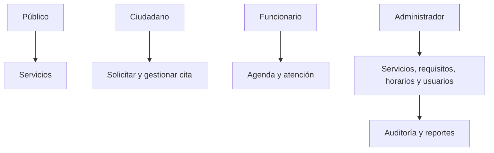

# Actividad 2 — Diseño funcional

**Objetivo:** centralizar la orientación y turnos de atención sin perder trazabilidad.

| Prioridad | Funciones reales |
|---|---|
| Críticas | registro/login, roles, servicios, disponibilidad, crear y consultar citas, transiciones de cita, administración de horarios |
| Necesarias | perfiles y sesiones, requisitos, asignación funcionario-servicio, auditoría, notificaciones, adjuntos |
| Complementarias | reportes CSV, agenda, calendario informativo de festivos |

Las vistas públicas son inicio, servicios y detalle; las de ciudadano incluyen tablero, nueva cita, mis citas, notificaciones y perfil; funcionario tiene agenda y detalle; administración incluye servicios/requisitos, horarios, usuarios, funcionarios, citas, auditoría y reportes. Los formularios envían datos a servicios HTTP; Express valida, persiste y devuelve JSON que React refleja en estado.

