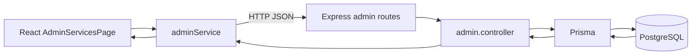

# Actividad 6 — Integración frontend-backend

El recurso demostrado es **Requirement** de un servicio. Desde `/admin/servicios`, el botón de requisitos abre la lista y el formulario. Flujo real:

Endpoints: `POST /api/v1/admin/services/:id/requirements`, `PATCH /api/v1/admin/requirements/:id`, `DELETE /api/v1/admin/requirements/:id`; el listado llega dentro de `GET /api/v1/admin/services`. El formulario valida título obligatorio; el backend vuelve a validar Zod. Tras crear, editar o eliminar, `AdminServicesPage` actualiza el estado `requirements` sin recarga manual.
